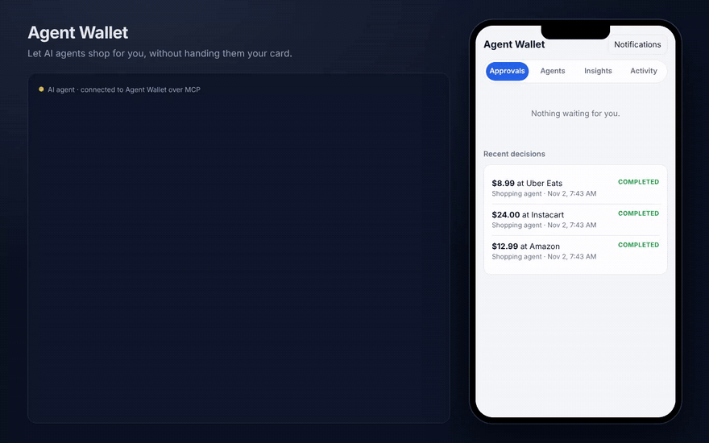

# Agent Wallet

**Let AI agents shop for you, without handing them your card.**

Spending rules, Face ID approvals, scam and price checks, and one-time cards for any AI agent. Open source, and set up in five minutes.

[](https://github.com/HeyanshShah/agent-wallet/actions/workflows/ci.yml)
[](LICENSE)
[](docs/AGENT-SPEND-PROTOCOL.md)



[Website](https://heyanshshah.github.io/agent-wallet/) · [Self-host](#self-host) · [Connect your agent](docs/INTEGRATE.md) · [Protocol](docs/AGENT-SPEND-PROTOCOL.md) · [Deploy](#deploy-so-your-phone-can-reach-it)

AI agents can now browse and check out, but handing one your real card is a bad idea. Agent Wallet sits between the agent and your money:

1. **You set rules per agent:** a monthly budget, a cap per purchase, allowed categories, blocked stores, and an auto-approve limit.
2. **The agent asks** through an MCP tool (`request_purchase`) or the REST API.
3. **The rules decide:** small purchases are approved instantly, bigger ones buzz your phone for a tap, and anything that breaks a rule is blocked.
4. **Approved purchases get a one-time card** locked to the approved amount. The agent never sees your real card.
5. **Everything is logged** in the Activity tab.

What makes it different:

- **Scam radar.** Every request is checked for lookalike stores (`amaz0n-deals.com`, `paypa1.com`), scam payment patterns (gift cards, crypto, wire transfers), double purchases, and amounts far above the agent's usual. A flagged purchase is never approved automatically, however small.
- **Price checks.** Before you tap Approve, it looks up the same product elsewhere: "💰 $72 cheaper at Target." The agent sees it too, so if you deny, it can buy it there instead.
- **Face ID approvals.** With a passkey set up, risky purchases and anything over an amount you choose need Face ID or your fingerprint. A stolen password alone can't approve them.
- **One-tap from the notification.** On Android and desktop, approve or deny right from the push notification without opening the app.
- **Signed approvals.** Every approved purchase comes with a token signed by your wallet that says who approved what, for how much, and how (automatically, by tap, or with Face ID). Any store, bank or payment network can check it against your wallet's public key, without trusting the agent.
- **Built for real money.** Card numbers are encrypted in the database and deleted once used, real charges arrive through signed Lithic webhooks, the activity log is tamper-evident, and with Face ID set up, nobody can loosen your rules with just your password.
- **Insights.** See spending by agent, category and store, the last 6 months, and how much money your rules stopped.
- **Works with any agent.** One-line install for Claude and any MCP client, plus an OpenAPI spec for everything else. See [docs/INTEGRATE.md](docs/INTEGRATE.md).

## Use it

**Agent Wallet Cloud:** sign up at [agent-wallet.onrender.com](https://agent-wallet.onrender.com) and you're done. It's free during early access, until November 2027.

## Self-host

Requires Node.js 22.13 or newer.

```bash
npm install
cp .env.example .env
npm start
```

The first start prints an **owner token**. Open http://localhost:3000, paste the token, and you're in the approval app.

To see all three outcomes, run the demo in a second terminal and approve the $89 request when it appears:

```bash
OWNER_TOKEN=aw_owner_... npm run demo
```

Or run it without cloning:

```bash
npx github:HeyanshShah/agent-wallet
```

## Deploy (so your phone can reach it)

Phone notifications and Face ID need HTTPS. The easiest route is [Render](https://render.com/deploy?repo=https://github.com/HeyanshShah/agent-wallet), which reads `render.yaml`: it builds the Dockerfile, adds a disk for the data, and generates the encryption key. Set `PUBLIC_URL` to the address Render gives you. `render.yaml` runs the hosted, sign-up version; for a private wallet just for you, set `HOSTED=0` and sign in with the generated `OWNER_TOKEN` (under the service's Environment tab).

## Hosted mode (many customers)

With `HOSTED=1`, one server runs a wallet for anyone who signs up:

- People create an account with an email and password (hashed with scrypt; sign-in attempts are rate limited) and get a 30-day session.
- **Each customer gets their own database file** in `DATA_DIR/tenants/`, with their own signing key, passkeys and push settings. Agent keys and card tokens are mapped to the right customer in `DATA_DIR/control.db`, so agents use the same `WALLET_URL` for everyone.
- Each customer's public routes (discovery, public key, `/verify`, notification buttons) live under `/t/<account id>/`, and that address is the issuer of their signed approvals.
- One Lithic webhook serves every customer: each charge is routed to the wallet that issued the card.
- Customers can delete their account and all its data from the Agents tab.
- `FREE_UNTIL` shows an early-access date in the app, and `SIGNUPS_OPEN=0` closes sign-ups.

Not yet in hosted mode: email verification and password reset (there's no email provider yet), and billing.

Any Docker host works too:

```bash
docker build -t agent-wallet .
docker run -p 3000:3000 -v wallet-data:/data -e OWNER_TOKEN=pick-a-long-secret -e PUBLIC_URL=https://your-domain agent-wallet
```

## Connect Claude (or any MCP agent)

In the app, go to **Agents → Add an agent**. Copy the key it shows (it is only shown once). For Claude Code:

```bash
claude mcp add agent-wallet -e WALLET_URL=http://localhost:3000 -e WALLET_AGENT_KEY=aw_agent_... \
  -- npx -y -p github:HeyanshShah/agent-wallet agent-wallet-mcp
```

For Claude Desktop and other MCP clients, add this to the config (for example `claude_desktop_config.json`):

```json
{
  "mcpServers": {
    "agent-wallet": {
      "command": "npx",
      "args": ["-y", "-p", "github:HeyanshShah/agent-wallet", "agent-wallet-mcp"],
      "env": {
        "WALLET_URL": "http://localhost:3000",
        "WALLET_AGENT_KEY": "aw_agent_..."
      }
    }
  }
}
```

The agent gets three tools:

| Tool | What it does |
| --- | --- |
| `check_budget` | Shows the agent its rules and what's left this month |
| `request_purchase` | Asks for money. Waits up to 2 minutes for your tap, and returns a one-time card if approved |
| `get_purchase_status` | Checks on a request that was still pending |

## Phone notifications

The approval app is a PWA. On your phone, open the server's URL, then **Add to Home Screen**, open it from there, and tap **Notifications**. iPhone needs iOS 16.4 or newer, and push only works over HTTPS. For a quick test from your phone, put the server behind a tunnel such as `cloudflared tunnel --url http://localhost:3000` or ngrok, and set `PUBLIC_URL` to the tunnel's address.

On Android and desktop Chrome, the notification has **Approve** and **Deny** buttons. iPhone doesn't support notification buttons, so tapping the notification opens the app. Purchases that need Face ID always open the app.

## Price checks

When an agent includes the product name (the MCP tool asks for it), pending purchases are checked against Google Shopping prices through [SerpApi](https://serpapi.com/google-shopping-api). Savings of at least $5 and 5% show on the approval card and in the notification, and come back to the agent as `cheaper_option`.

- Real prices: set `SERPAPI_KEY` (their free plan covers a small number of searches a month).
- To try it without a key: set `PRICE_CHECK=demo`. Prices are made up and labeled "demo prices" in the app.
- Neither set: price checks are off.

The SerpApi integration is tested against a recorded response shape, not a live key.

## Face ID approvals

Go to **Agents → Set up Face ID**. Once a passkey is set up, risky purchases always need it, and you can also require it over an amount. Passkeys are tied to the server's address, so set `PUBLIC_URL` to the exact URL you open the app at.

## Real cards

| `CARD_ISSUER` | What happens |
| --- | --- |
| `mock` (default) | Fake, Luhn-valid test cards. No money moves. `POST /v1/cards/:id/charge` pretends to be a store charging the card |
| `lithic` | Real virtual cards from [Lithic](https://lithic.com). Cards are `SINGLE_USE` with a per-transaction limit equal to the approved amount, so the card network itself refuses a second charge or a bigger one |

To go live with Lithic:

1. Get a sandbox API key, and set `CARD_ISSUER=lithic`, `LITHIC_API_KEY` and `LITHIC_BASE_URL=https://sandbox.lithic.com`.
2. In Lithic's dashboard, add a webhook to `https://your-wallet/webhooks/lithic` for card transaction events, and set `LITHIC_WEBHOOK_SECRET` to its signing secret (`whsec_...`). Every delivery's signature and timestamp are checked, and a charge delivered twice is only counted once. If a used card is ever charged again, you get an alert in Activity.
3. Make a test purchase, then switch to the production key and `LITHIC_BASE_URL=https://api.lithic.com`.

> The Lithic connector and webhook handler are tested against Lithic's documented request and event formats, not yet against a live account. Run step 3 in the sandbox before real money.

## Security

- **Card details are encrypted at rest** with AES-256-GCM. The key comes from `WALLET_ENCRYPTION_KEY` (Render generates one), or from a `wallet.key` file created next to the database. A copied database is useless without it, so keep the key somewhere else and back it up. Card numbers are deleted as soon as the card is used.
- **Face ID locks your rules.** Once a passkey is set up, raising a budget, adding an agent or switching off Face ID checks needs Face ID too, so a stolen owner token can't loosen anything. Pausing an agent never needs it.
- **Tamper-evident log.** Each Activity entry includes a hash of the one before. The Activity tab checks the whole chain and warns if anything was edited or removed (`GET /api/events/verify`).
- **Abuse limits.** Repeated wrong keys from one address are slowed down, each agent can make 30 purchase requests a minute, and request bodies over 64 KB are refused. Security headers are on, and token checks are constant-time.

Found a security problem? Please report it privately; see [CONTRIBUTING.md](CONTRIBUTING.md#security).

## Signed approvals

Approved purchases include `approval_token`, a compact JWS signed with the wallet's Ed25519 key:

```json
{ "iss": "https://your-wallet", "sub": "<agent id>", "jti": "<request id>", "amount": { "value": 8900, "currency": "USD" },
  "merchant": "Best Buy", "approval": "owner_passkey", "risk": ["new_merchant"], "card_last4": "4242", "iat": 1793000000, "exp": 1793086400 }
```

`approval` is `auto`, `owner` (a tap) or `owner_passkey` (Face ID). Anyone can check a token against `/.well-known/jwks.json`, or send it to `POST /verify`. `verifyApproval()` in [`src/signer.ts`](src/signer.ts) has no other dependencies, so a store can copy it.

## API

Agent endpoints use `Authorization: Bearer <agent key>`:

- `GET /v1/me`: the agent's rules and remaining budget
- `POST /v1/purchases` `{ amount_cents, merchant, category?, reason }`: returns `auto_approved` (with `card`), `pending`, or `blocked` (HTTP 403)
- `GET /v1/purchases/:id`: poll a request. `card` appears once it's approved

Owner endpoints use `Authorization: Bearer <owner token>`:

- `GET/POST /api/agents`, `PATCH /api/agents/:id`
- `GET /api/requests?status=pending`, `POST /api/requests/:id/approve`, `POST /api/requests/:id/deny`
- `GET /api/events` (activity log), `GET /api/events/verify`, `GET /api/insights`, `GET /api/stream` (live updates over SSE)
- `GET/PATCH /api/settings`, `POST /api/passkeys/register/options`, `POST /api/passkeys/register/verify`, `POST /api/requests/:id/approve/options`, `POST /api/passkeys/rules/options`

Public: `GET /.well-known/agent-spend`, `GET /.well-known/jwks.json`, `POST /verify`, and `POST /webhooks/lithic` (signed by Lithic).

The full agent API is described in [`public/openapi.json`](public/openapi.json), which is also served at `/openapi.json`.

## How the rules work

The rule checks run in this order, and the first one that fails blocks the purchase: agent paused → blocked store → category not allowed → over the per-purchase cap → over the remaining monthly budget. If none fail, the purchase is auto-approved when it's at or under the auto-approve limit; otherwise it waits for you. When you tap Approve, the rules run again, so a budget you lowered in the meantime still applies. Unanswered requests expire after 15 minutes.

Risk checks run alongside the rules, in [`src/risk.ts`](src/risk.ts). They never block a purchase on their own. Instead they make sure you see it, with the warning, and that big ones need Face ID.

Both are pure functions, so they're easy to test and change.

## The Agent Spend Protocol

Agent Wallet implements an open draft standard for how agents ask wallets for money: [docs/AGENT-SPEND-PROTOCOL.md](docs/AGENT-SPEND-PROTOCOL.md). A wallet publishes `/.well-known/agent-spend`, and agents send one request shape and handle seven statuses. Retries are safe with an `Idempotency-Key` header. Draft 0.2 adds signed approvals that anyone can verify. The protocol is rail-neutral: the credential can be a virtual card today, and network tokens later. Feedback is welcome as issues.

## Development

```bash
npm test          # rules, risk, prices, API and security tests
npm run typecheck
npm run dev       # restart on changes
```

| File | What's in it |
| --- | --- |
| `src/rules.ts` | Rules engine |
| `src/risk.ts` | Scam and anomaly checks |
| `src/passkeys.ts` | Face ID / fingerprint approvals |
| `src/signer.ts` | Signed approvals and their verifier |
| `src/vault.ts` | Encryption of card details at rest |
| `src/lithic-webhooks.ts` | Real charges from Lithic |
| `src/prices.ts` | Price checks |
| `src/wallet.ts` | Agents, requests, approvals, cards, activity log |
| `src/cards.ts` | Mock and Lithic card issuers |
| `src/app.ts` | HTTP API for one wallet |
| `src/hosted.ts` | Accounts, sign-up and one wallet per customer |
| `src/mcp.ts` | MCP server for agents |
| `src/notify.ts` | Live updates and web push |
| `public/` | The approval app |

## Contributing

See [CONTRIBUTING.md](CONTRIBUTING.md). Good first issues: new scam patterns, new card issuers, and agent framework examples.

## Next steps

- Merchant-locked cards, so a card only works at the approved store
- Multiple users and families with real sign-in
- A native iPhone app with notification buttons
- Approval tokens mapped onto Google AP2 mandates, Visa Intelligent Commerce and Mastercard Agent Pay

## License

[MIT](LICENSE)
